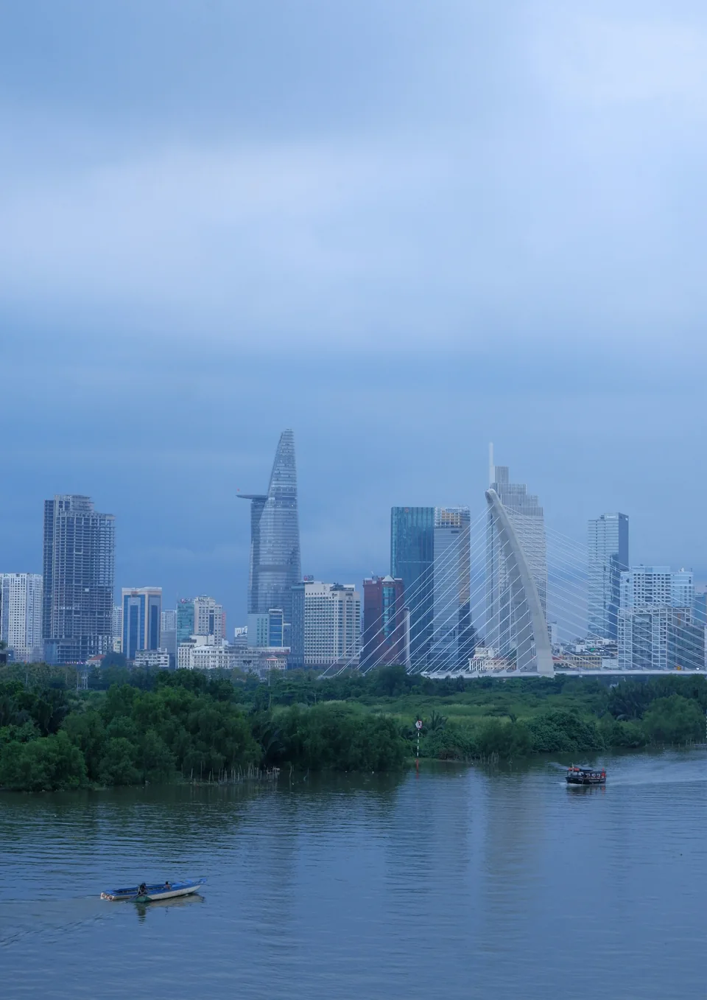
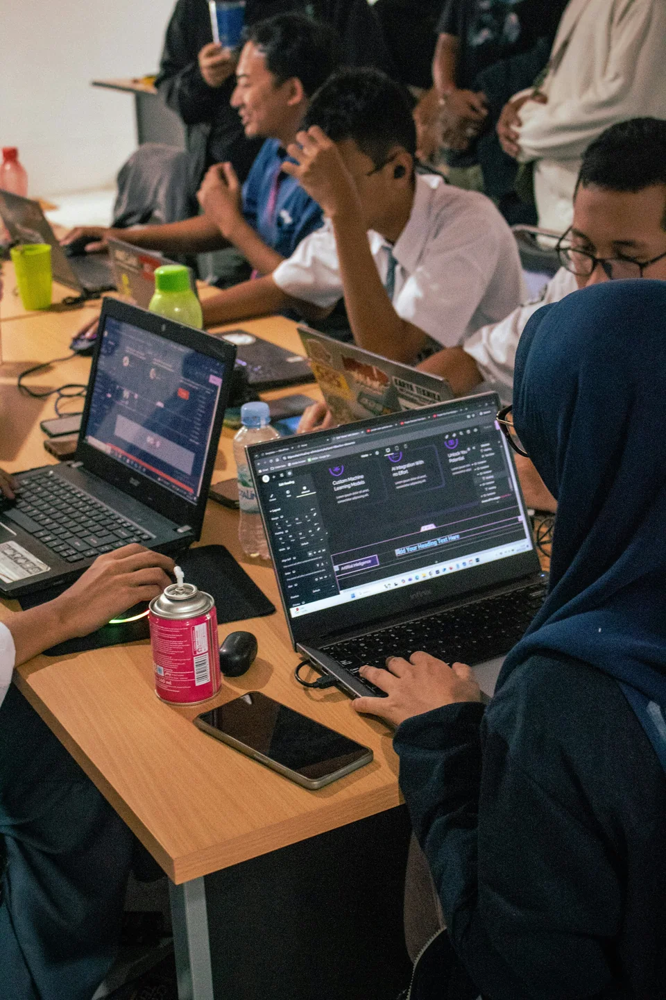
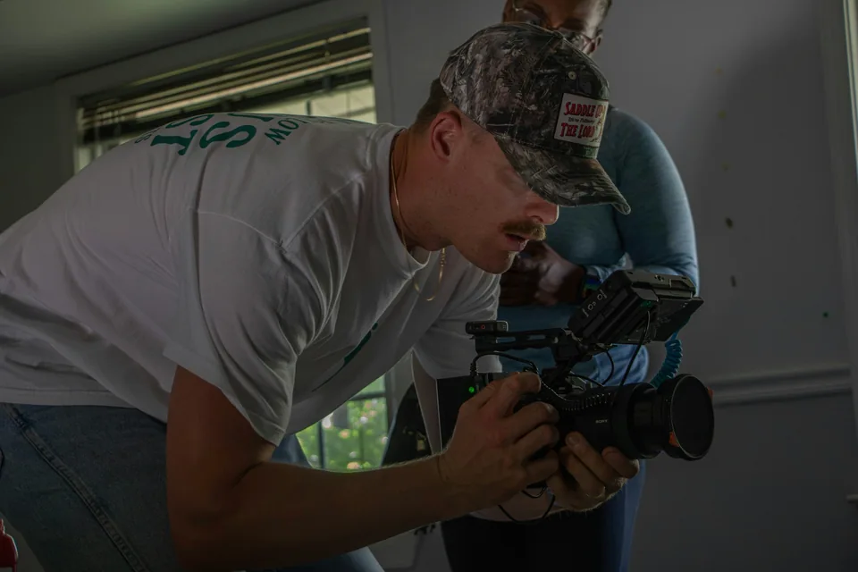
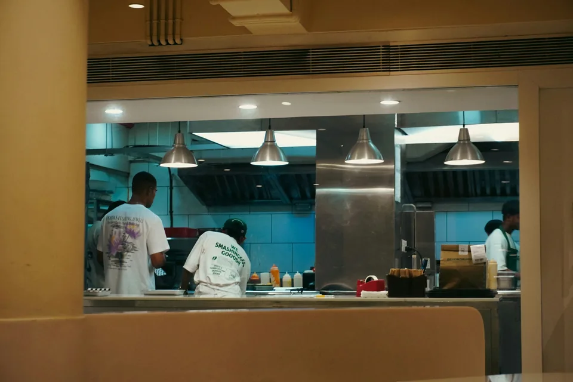
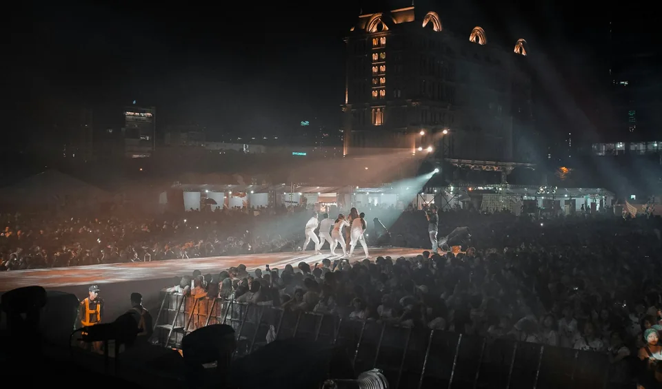

# DCG GROUP — Photo selection board

**“Tinh thần Việt trong đời sống đương đại”** · Tư liệu kiểm tra nguồn và chất lượng ảnh trên website.

Tất cả ảnh dưới đây đều là ảnh chụp thật, không phải ảnh sinh bằng AI. Ảnh Unsplash dùng theo giấy phép miễn phí có quyền sử dụng thương mại, không bắt buộc ghi công khai tác giả; nguồn, giấy phép và tên tác giả được lưu ở đây. Không dùng hình minh họa bên ngoài để mô tả cơ sở, khách hàng hoặc nhân viên của DCG.

## 1. DCG GROUP — Đô thị TP.HCM

- Ảnh: [Kate Le — Unsplash](https://unsplash.com/photos/city-skyline-view-with-river-and-bridge-TJvH2nqycvE), giấy phép [Unsplash License](https://unsplash.com/license).
- Vị trí: Home hero; ảnh bên phải tiêu đề Giới thiệu.
- Trạng thái: **Ảnh minh họa TP.HCM**, không phải cơ sở của DCG.
- Focal point: desktop trung tâm hướng sông/cầu (50% x, 70% y); mobile banner dọc 4:5; không ghép logo.
- Alt: “Đô thị và cầu tại Thành phố Hồ Chí Minh, ảnh chụp minh họa”.

## 2. DCG TALENT / DCG GROWMATCH — Học tập và phát triển nghề nghiệp

- Nguồn: [Vitaly Gariev — Unsplash](https://unsplash.com/photos/diverse-group-of-students-gathered-around-a-laptop-8gAbl776pc0); [Unsplash License miễn phí](https://unsplash.com/license).
- Quyền: Cho phép sử dụng thương mại **không bắt buộc hiển thị tên tác giả trên website**. Hồ sơ nguồn lưu trong repository.
- Vị trí: hình đại diện DCG TALENT trên Hệ sinh thái, trang thương hiệu, Giải pháp và hình minh họa dự án DCG GROWMATCH.
- Trạng thái: **Ảnh minh họa**, những người trong ảnh không phải nhân viên hoặc thành viên DCG.
- Bản ảnh: nguồn JPG không sửa, WebP 1600×900 và 960×540; dùng crop 16:10 ở vị trí thương hiệu với tiêu điểm 50% / 48%; không áp hiệu ứng màu.
- Alt: “Nhóm sinh viên cùng trao đổi và học tập quanh máy tính, ảnh minh họa, không phải đội ngũ DCG TALENT”.
- Ảnh NTTU của đội ĐÀN CÁ GỖ **không còn dùng làm ảnh đại diện thương hiệu**, nhưng cả `FBA1C8B9-ED38-42D6-8EF9-50CBECBFA44D.jpeg` và `NTTU_0058.jpeg` vẫn được giữ nguyên trong **bài thành tích DCG GROWMATCH**.

## 3. DCG STUDIO — Hậu trường máy quay

- Ảnh: [Jamie Webster — Unsplash](https://unsplash.com/photos/filmmaker-operating-a-camera-indoors-with-another-person-behind-skQLP2oB09k), giấy phép [Unsplash License](https://unsplash.com/license).
- Vị trí: hệ sinh thái, thương hiệu, giải pháp.
- Trạng thái: **Ảnh minh họa từ bên ngoài DCG**; không đại diện nhân sự hay máy quay thực tế của DCG.
- Crop: 16:10 desktop/tablet/mobile, điểm lấy nét 50% / 48%.
- Alt: “Người vận hành máy quay trong một buổi sản xuất video, ảnh chụp minh họa bên ngoài DCG STUDIO”.

## 4. DCG VISION / LUMIQC — Chế biến thực phẩm

- Ảnh: [Adhitya Sibikumar — Unsplash](https://unsplash.com/photos/people-working-in-a-commercial-kitchen-YFK5dBI6Ftc), giấy phép [Unsplash License](https://unsplash.com/license).
- Vị trí: hệ sinh thái, thương hiệu, giải pháp và LUMIQC.
- Trạng thái: **Ảnh minh họa ngành F&B**, không phải triển khai AI hay camera đã nghiệm thu của LUMIQC.
- Crop: 16:10, trọng tâm chính giữa; không thêm bounding boxes, bảng AI giả hoặc máy móc giả.
- Alt: “Nhân viên chế biến thực phẩm trong bếp chuyên nghiệp, ảnh minh họa, không phải thử nghiệm LUMIQC”.

## 5. DCG ENTERTAINMENT — Biểu diễn tại Việt Nam

- Ảnh: [Tony Pham — Unsplash](https://unsplash.com/photos/people-watching-a-band-performing-on-stage-during-nighttime-2L6FJbsWtCg), giấy phép [Unsplash License](https://unsplash.com/license).
- Vị trí: hệ sinh thái, trang thương hiệu và thẻ giải pháp.
- Trạng thái: **Ảnh chụp biểu diễn thật tại Việt Nam**, không phải sự kiện DCG tổ chức.
- Crop: 16:10, tâm khung sân khấu, 50% / 46%.
- Alt: “Sân khấu biểu diễn thực tế tại Thành phố Hồ Chí Minh, ảnh minh họa, không phải sự kiện của DCG ENTERTAINMENT”.

---

Đối chiếu chi tiết giấy phép, điểm cắt, trạng thái tư liệu và các nhu cầu còn thiếu trong [IMAGE_PROVENANCE.md](./IMAGE_PROVENANCE.md). Các bản WebP `1600` và `960` được sinh từ ảnh JPG nguồn lưu tại `public/assets/editorial`; không được tô màu xanh-vàng lên nội dung ảnh.

**Lưu ý:** Hình ảnh Talent, Studio, bếp và sân khấu hiện là minh họa được cấp phép chứ chưa phải ảnh hoạt động sản xuất của DCG. Khi có ảnh tư liệu thật cùng quyền xuất bản, có thể thay tương ứng theo vị trí trong bảng.
